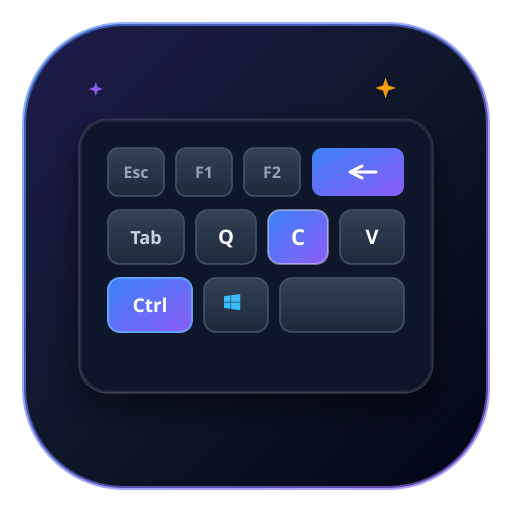

# ⌨️ Shortcuts Master (سيد الاختصارات)

> A modern, offline-first Progressive Web Application (PWA) to organize, search, copy, and auto-generate keyboard shortcuts for Windows, Microsoft Office, and any desktop software with Google Gemini AI and Google Drive Cloud Sync.



---

## ✨ Features

- 🖥️ **Pre-loaded Desktop Shortcuts**:
  - **Windows 11**: Snap layouts, virtual desktops, task management, clipboard history, snipping tool.
  - **Microsoft Excel**: Formulas ($A$1 toggle), AutoSum, table creation, cell formatting, navigation.
  - **Microsoft Word**: Text styles, paragraph alignment, line spacing, navigation pane.
  - **Google Chrome**: Tab controls, incognito, omnibox, bookmarks, DevTools inspection.
  - **Visual Studio Code**: Command Palette, multi-cursor, line manipulation, terminal toggle, refactoring.
  - **Windows Terminal / PowerShell**: Split panes, tabs, buffer search, zoom, keyboard navigation.

- 🤖 **Gemini AI Auto-Generator**:
  - Enter any software name (e.g. *Adobe Photoshop*, *Figma*, *Blender*, *AutoCAD*, *Slack*, *IntelliJ*).
  - Gemini AI automatically returns 15–25 accurate Windows shortcuts categorized by function.
  - Preview, select, and import directly into your library with one click!

- 📋 **One-Click Copy**:
  - Sleek 3D `<kbd>` key representations.
  - Click any shortcut or the copy button to copy keys directly to your clipboard.

- ☁️ **Google Drive Sync & Local Backup**:
  - Connect your Google account using your OAuth 2.0 Client ID.
  - Backup your custom shortcuts and apps to `shortcuts_master_backup.json` on your Google Drive.
  - Restore anytime across any device.
  - Also supports zero-setup instant local JSON Export/Import!

- 🌐 **Full Bilingual Support (EN & AR)**:
  - Default: **English**.
  - Toggle to **العربية**: Complete Right-to-Left (RTL) layout, Arabic typography, and translated system actions.

- 🌙 **Dark / Light Fluent Theme**:
  - Designed with Windows 11 Fluent Design & Glassmorphism.
  - Instant theme switcher with memory.

- 📱 **PWA & Offline First**:
  - Installable directly to your Windows desktop or mobile home screen as a native application.
  - Works 100% offline via Service Worker & IndexedDB.

---

## 🚀 How to Run Locally

You can open `index.html` directly in any modern browser, or serve it using any simple static HTTP server:

```powershell
# Using Python
python -m http.server 8000

# Using Node.js npx serve
npx serve .
```

Then visit `http://localhost:8000`.

---

## 🌐 How to Deploy on GitHub Pages

1. Create a repository on GitHub (e.g. `shortcuts`).
2. Push this project code:
   ```bash
   git init
   git add .
   git commit -m "Initial commit of Shortcuts Master PWA"
   git branch -M main
   git remote add origin https://github.com/<YOUR_USERNAME>/shortcuts.git
   git push -u origin main
   ```
3. In your GitHub repository:
   - Go to **Settings** > **Pages**.
   - Under **Source**, select `Deploy from a branch`.
   - Select Branch: `main` / `root` and click **Save**.
4. Your site will be live at `https://<YOUR_USERNAME>.github.io/shortcuts/`!

---

## 🔑 How to Get a Free Gemini API Key

1. Go to [Google AI Studio](https://aistudio.google.com/).
2. Sign in with your Google account.
3. Click **Get API key** > **Create API key in new project**.
4. Copy the API key.
5. In Shortcuts Master, click the **Settings (⚙️)** icon, paste your key in **Gemini API Key**, and click **Save Settings**.

---

## ☁️ How to Set Up Google Drive Sync (Optional)

1. Open the [Google Cloud Console](https://console.cloud.google.com/).
2. Create a new project (e.g. `Shortcuts Sync`).
3. Enable the **Google Drive API**:
   - Go to **APIs & Services** > **Library**, search for `Google Drive API` and click **Enable**.
4. Configure the **OAuth Consent Screen**:
   - User Type: **External**
   - App Name: `Shortcuts Master`
   - Add your test email to test users.
5. Create **OAuth 2.0 Client ID**:
   - Go to **APIs & Services** > **Credentials** > **Create Credentials** > **OAuth Client ID**.
   - Application Type: **Web application**.
   - Under **Authorized JavaScript origins**, add:
     - `http://localhost:8000` (for local development)
     - `https://<YOUR_USERNAME>.github.io` (for GitHub Pages)
6. Copy your **Client ID** (ends with `.apps.googleusercontent.com`).
7. In Shortcuts Master Settings, paste the Client ID and click **Save Settings**.
8. Now you can click **Backup to Google Drive** or **Restore from Google Drive** anytime!

---

## 📂 Project Structure

```
├── index.html              # Main HTML markup, modals & navigation
├── manifest.webmanifest    # PWA web manifest
├── service-worker.js       # Offline caching & service worker
├── css/
│   ├── themes.css          # Design tokens & dark/light palettes
│   ├── styles.css          # Responsive design & components
│   └── rtl.css             # Right-to-Left Arabic styling
├── js/
│   ├── icons.js            # SVG icons & vector assets
│   ├── default-data.js     # Built-in shortcuts database
│   ├── i18n.js             # English and Arabic dictionaries
│   ├── db.js               # IndexedDB storage layer
│   ├── gemini.js           # Gemini AI API integration
│   ├── drive-sync.js       # Google Drive OAuth2 & sync
│   ├── ui.js               # UI interaction & modal controller
│   └── app.js              # Main application router & logic
└── assets/
    └── icons/
        └── icon.svg        # Scalable application icon
```

---

## 🛡️ Privacy & Security

- All your custom applications and shortcuts are stored **locally on your device** in IndexedDB.
- Your Gemini API key is stored only in your browser's local storage.
- Google Drive sync only accesses files created by this application (`shortcuts_master_backup.json`) using the restricted `drive.file` scope.
